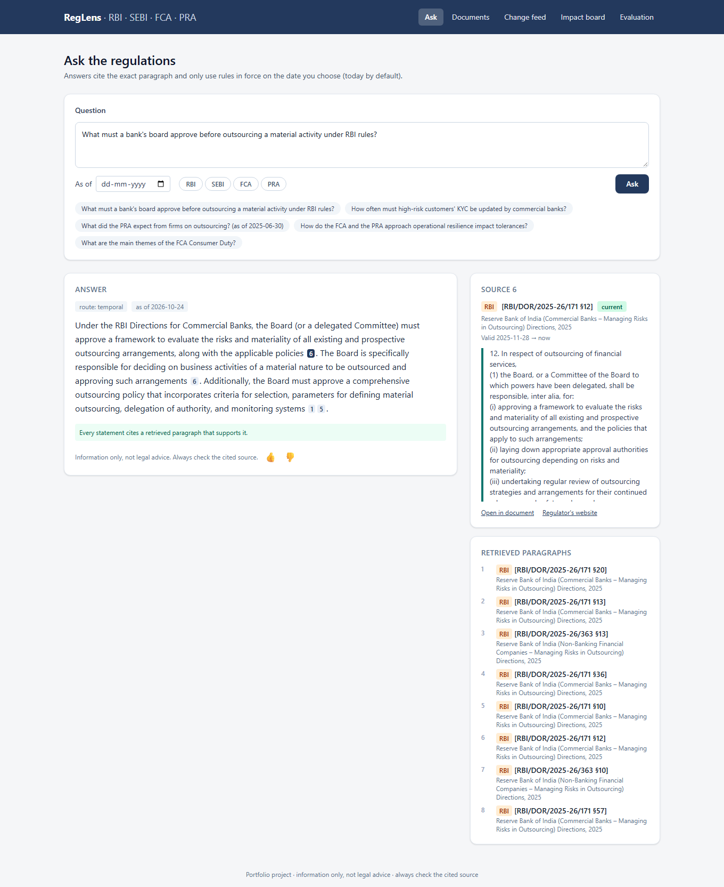
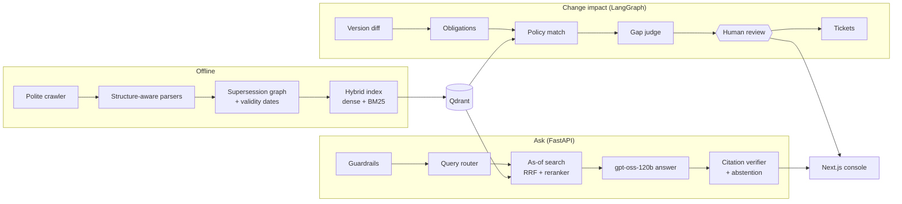

# RegLens: regulatory change-impact copilot (RBI · SEBI · FCA · PRA)

[](https://github.com/Brahme27/reglens/actions/workflows/ci.yml)
 

Ask a regulatory question and get an answer that cites the exact paragraph **as the rules
stood on any date you choose**. When a regulator publishes a new version, RegLens extracts the
obligations that changed and checks them against a bank's internal policies. It then drafts gap
tickets and pauses for a human to approve them. It is built on 37 real documents (48 versions,
4,835 paragraphs), including superseded ones, and runs on a laptop CPU with free open models.



## Results (195-question golden set)

| | Naive RAG | RegLens |
|---|---|---|
| Retrieval nDCG@10 / MRR | 0.652 / 0.619 | **0.853 / 0.869** |
| Repealed or not-yet-in-force paragraph in the top 5 | 64% | **0%** |
| Answer faithfulness / citation precision (LLM judge) | 0.72 / 0.68 | **0.87 / 0.84** |
| Answers citing only rules in force on the date asked | 0.86 | **1.00** |

| Also measured | |
|---|---|
| Abstains on unanswerable questions · refuses adversarial prompts | **100%** · **90%** |
| Gap judgement on 41 planted gaps (accuracy) | **0.927** |
| Supersession detection (F1) | **0.982** |
| End-to-end latency on a CPU (p50 / p95) | 1.4 s / 2.2 s |

Full numbers and the one-technique-at-a-time ablation: [docs/RESULTS.md](docs/RESULTS.md).

## Architecture



## What makes it interesting

- **Time-aware retrieval:** "as of a date" is a hard filter on validity intervals, so repealed text cannot leak in.
- **Measured, not assumed:** an ablation kept only what helped. LLM document summaries *lowered*
  nDCG (0.824 → 0.734) and were not shipped.
- **Human in the loop for real:** LangGraph `interrupt()` pauses the gap workflow until a reviewer approves.
- **"I don't know" is a feature:** a calibrated abstention threshold plus a `NOT_FOUND` contract with the model.
- **Defended against prompt injection:** input rails, Llama Prompt Guard 2, and a rail that drops poisoned passages.

## Tech stack

Python 3.12 · LangGraph · LiteLLM → Groq (gpt-oss-120b/20b, Qwen judge) · Qdrant hybrid search ·
bge-small + BM25 · MiniLM cross-encoder · FastAPI (SSE) · Postgres · Redis semantic cache ·
Next.js 16 · Playwright · Prometheus/Grafana · Docker Compose · Terraform (AWS ECS Fargate) · GitHub Actions

## Run it

```bash
uv sync && cp .env.example .env    # add REGLENS_GROQ_API_KEY (cached answers replay without it)
uv run poe pipeline                # crawl → parse → time model → indexes → router
docker compose up -d --build       # console http://localhost:3000 · API :8000/docs
```

## Learn more

- [Walkthrough](walkthrough/README.md): the build story in plain English
- [Results](docs/RESULTS.md) · [Limitations](docs/LIMITATIONS.md) · [Decisions (ADRs)](docs/adr/)
- **Known weak spots:** comparison questions (nDCG@10 0.58) and 18% false abstention on hard questions.

*RegLens quotes regulatory text. It is not legal advice, and every gap judgement is a draft for a human reviewer.*
