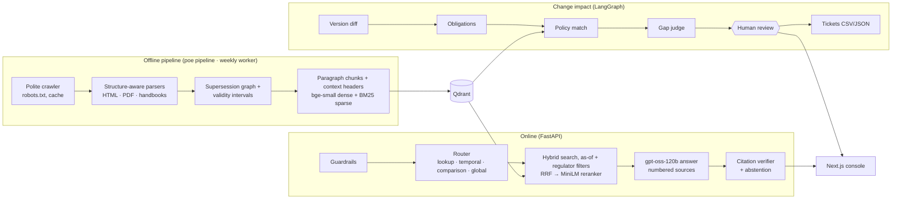

# RegLens: regulatory change-impact copilot (RBI · SEBI · FCA · PRA)

[](../../actions)
 

**Ask a regulatory question and get an answer that cites the exact paragraph, as the rules
stood on any date you choose. When a regulator publishes a new version, RegLens extracts the
obligations that changed, checks them against a bank's internal policies, and drafts gap
tickets for a human to approve.**

It is built on 37 real documents (48 versions, 4,835 paragraphs) from India's RBI and SEBI and
the UK's FCA and PRA, including superseded versions. Everything runs on a laptop CPU with free
open models. It ships as a FastAPI service, a Next.js compliance console, Docker Compose and
AWS Terraform (validated, not applied).

> 📖 **New here? Read the build story:** [walkthrough/README.md](walkthrough/README.md) explains
> every step in plain English, from creating the environment to the deployment files.


---

## Why this is hard (and what RegLens does about it)
| Problem in compliance search | What RegLens does |
|---|---|
| Rules are replaced, and a repealed paragraph looks just as relevant as the current one | A **supersession graph** and validity intervals per paragraph; every search is filtered "as of" a date |
| An answer is only useful if you can check it | Numbered sources, a **citation verifier**, and paragraph-level links to the source text |
| "Not in the sources" must be a real answer | A calibrated **abstention** threshold plus a `NOT_FOUND` contract with the model |
| A new circular means weeks of manual gap analysis | A **LangGraph** workflow: diff versions → extract obligations → match policies → judge gaps → **pause for human review** → tickets |
| LLM tools can be talked into things | Input rails, Llama Prompt Guard 2, and a context rail that drops poisoned passages |

<details>
<summary>Change-impact board: a PRA rewrite checked against a bank's outsourcing policy, paused for review</summary>


</details>

## Results
All numbers come from code (`uv run poe ablation`, `eval-answers`, `eval-impact`, `results`)
and are published in **[docs/RESULTS.md](docs/RESULTS.md)**. The golden set has 195 questions:
lookup, temporal, comparison, global, unanswerable and adversarial.

| What | Result |
|---|---|
| Retrieval, naive RAG → production (recall@10 / nDCG@10 / MRR) | 0.810 / 0.652 / 0.619 → **0.914 / 0.853 / 0.869** |
| Repealed or not-yet-in-force paragraph in the top 5 | **64% → 0%** |
| Answer faithfulness / citation precision (LLM judge, different model family) | naive 0.72 / 0.68 → **0.87 / 0.84** |
| Answers citing only paragraphs in force on the question's date | naive 0.86 → **1.00** |
| Abstains on unanswerable questions · refuses adversarial prompts | **100%** · **90%** |
| Supersession edges (57 gold): rules only → rules + LLM, F1 | 0.944 → **0.982** |
| Query router accuracy (lookup / temporal / comparison / global) | **0.903** |
| Gap judgement on 41 planted gaps: covered-vs-gap accuracy · Cohen's κ | **0.927** · 0.646 |
| Obligation extraction: recall / judged precision | 0.634 / 1.000 |
| Latency, end to end, uncached (p50 / p95, laptop CPU) | 1.4 s / 2.2 s |
| Engineering | 161 tests (91% coverage) · 8 Playwright E2E · smoke tests on Docker Compose · CI quality gate |

**The ablation**, one technique at a time (full table in
[walkthrough 08/03](walkthrough/08-evaluation/03-the-ablation.md)): paragraph chunks gave the biggest
ranking gain, the reranker moved answers up the list, context headers lifted lookups, and the
as-of filter removed stale passages entirely. Two ideas lost and were **not shipped**:
LLM document summaries (nDCG 0.824 → 0.734) and document-diverse retrieval.

**What the evaluations caught** ([walkthrough 08/05](walkthrough/08-evaluation/05-what-we-learned.md)):
the planned bge-m3 reranker cost 9× the latency for +0.025 nDCG on CPU; a learned "off-topic"
class would have refused 27 real questions; the LLM invented one repeal (now human-reviewed);
the judge silently scored only 7 answers until its hidden reasoning was switched off; and the
safety rail refused anti-money-laundering questions until it was rewritten to look for intent.

**Known weak spots:** comparison questions (nDCG@10 0.58) and an 18% false-abstention rate on
hard questions. Both are in [docs/LIMITATIONS.md](docs/LIMITATIONS.md).

## Architecture

Supporting services: Postgres (feedback, obligations, gap reviews), Redis (semantic cache),
Langfuse-compatible tracing, Prometheus metrics with Grafana dashboards and alerts.

## Quickstart
Prerequisites: [uv](https://docs.astral.sh/uv/), Docker Desktop, Node 24 + pnpm (console only),
and a free [Groq API key](https://console.groq.com/keys) (optional: cached answers replay without it).
```bash
uv sync
cp .env.example .env                 # add REGLENS_GROQ_API_KEY (never commit .env)
uv run poe pipeline                  # crawl → parse → time model → indexes → router
docker compose up -d --build         # postgres, qdrant, redis, indexer, api, console
uv run python -m reglens.smoke --api http://localhost:8000 --web http://localhost:3000
```
Console: <http://localhost:3000> · API docs: <http://localhost:8000/docs> · Monitoring:
`docker compose --profile monitoring up -d` (Grafana on :3001).

## Tech choices (and why)
| Layer | Choice | Why |
|---|---|---|
| LLMs | gpt-oss-120b / 20b, Qwen as judge and fallback, via LiteLLM on Groq | Free, open-weight, OpenAI-compatible; provider swap is one YAML file |
| Retrieval | Qdrant hybrid (dense + BM25), RRF, MiniLM-L6 cross-encoder | Exact rule numbers need keywords; meaning needs dense; CPU-sized reranker (ADR 0004) |
| Time | Supersession graph + validity payload filters | Correctness "as of" a date is a filter, not a ranking hope |
| Workflow | LangGraph with `interrupt()` | Real human-in-the-loop pause and resume for gap review (ADR 0003) |
| Serving | FastAPI + SSE streaming, Next.js BFF proxy | API key stays server-side; answers stream token by token |
| Infra | Docker Compose; Terraform for ECS Fargate, RDS, ElastiCache, EFS | Same images locally and in the cloud; `terraform validate` in CI, never applied |

## Repository map
| Path | What |
|---|---|
| `src/reglens/corpus`, `parse`, `temporal` | Crawling, parsing, supersession and validity |
| `src/reglens/index`, `retrieve`, `generate`, `guard` | Indexing, retrieval, answers, guardrails |
| `src/reglens/impact` | Version diff, obligations, policy search, LangGraph workflow |
| `src/reglens/evals` | Golden set, ablation, LLM judge, impact eval, CI quality gate |
| `src/reglens/api`, `frontend/` | FastAPI service and the Next.js console |
| `infra/terraform`, `deploy/monitoring`, `.github/workflows` | Cloud, monitoring and CI |
| `docs/adr`, `docs/RESULTS.md`, `docs/LIMITATIONS.md` | Decisions, numbers, honest caveats |

*RegLens finds and quotes regulatory text. It is not legal advice, and every gap judgement is a
draft for a human reviewer.*
