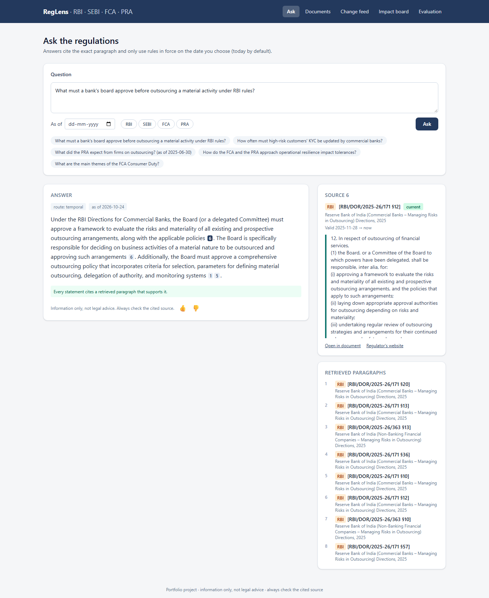
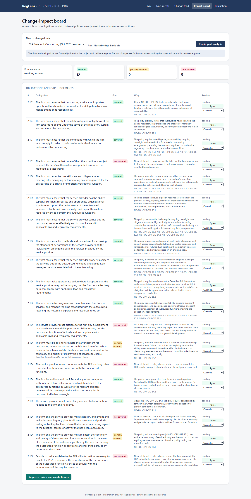

[RegLens guide](../README.md) › Part 12: The API and the console

# 12.1 The API and the console

In [Part 11](../11-safety-and-speed/02-faster-and-visible.md) we wrapped every question in guards,
a cache and a flight recorder. Everything works, but only from inside Python. Meera doesn't write
Python. She needs a web page, and other systems in the bank need a door to knock on. This chapter
builds both, and the safe corridor between them.

## The front door: an API

An **API** (application programming interface) is a set of addresses that other programs can call,
each doing one job. RegLens's API is built with **FastAPI**, a modern Python web framework. It
checks every incoming request against a typed description (the same pydantic we met in chapter 2.3)
and writes an interactive documentation page by itself. Flask is the classic alternative, but it
leaves input checking and documentation to you.

The main doors are: ask a question (streamed, as in chapter 8.3, or as one plain reply); send
thumbs-up or thumbs-down feedback; list documents, their versions, their validity and what
replaced what; compare two versions paragraph by paragraph; see a feed of recent changes; run,
review and approve an impact analysis and download its tickets; and read the evaluation reports.
Three more doors, `/health`, `/ready` and `/metrics`, tell machines whether the service is alive,
ready, and how it's doing.

A few production habits protect it:

- **An API key** on every main door, compared in a way that doesn't leak hints through timing.
- **A rate limit** of 30 questions a minute per client, so one caller can't burn the whole free
  model quota. It works like a jar of tokens refilled at a steady pace: each question takes one,
  and an empty jar means "wait".
- **Validation**: a one-letter question, an unknown regulator such as "ECB", or an override with no
  verdict are rejected before any work starts.
- **Allow-lists, not file paths**: report names are checked against a fixed list, so a sneaky name
  like `../../etc/passwd` gets a polite "not found".

> **Try it:** run `uv run poe api` (after `uv run poe pipeline` has built the indexes), then open
> `http://127.0.0.1:8000/docs`. You'll see every endpoint listed, and you can send a question from
> the page itself.

## The console Meera uses

The **frontend** is the part of a system people see and click. Ours is a console built with
**Next.js**, a popular framework for web applications written in TypeScript. It has five pages:
**Ask**, **Documents** (every document with its status and validity window, a viewer that
highlights the cited paragraph, and a word-by-word comparison between versions), **Change feed**
(what came into force, what's scheduled, what stopped applying), **Impact board**, and
**Evaluation** (the measurements from Part 9, read live from the reports).

The screenshot shows a different question from Meera's, but the same shape: the route and date at
the top of the answer, numbered markers, the green verification note, and on the right the cited
paragraph with its status, validity window and links to the document and the regulator's website.

The impact board shows a run for the UK test bank, paused for review: each obligation, its verdict,
the reason, and the Agree and Override controls from chapter 10.2. Both test firms are labelled as
fictional on the page, and every answer carries a "not legal advice" note.

The console is tested by **Playwright**, a tool that drives a real browser and clicks through the
pages like a person would; against the running stack, all 8 end-to-end tests pass.

## A corridor with a staff badge

The browser never calls the API directly. It calls a small **proxy** on the console's own server,
which passes requests on. The proxy checks the path against an allow-list, adds the secret API key
**on the server**, and streams the reply straight back without holding it, so answers still appear
word by word. This pattern is called a **backend-for-frontend**.

Why the detour? Anything sent to a browser can be read by its user, so a key inside the web page
would be a published key. The browser also talks to only one website, which avoids **CORS**
problems (browser rules that limit which sites may call which). And only the allow-listed parts of
the API are reachable from outside. Think of a receptionist who carries your request to the back
office using a staff badge: you never get the badge, and you can only ask for things on the menu.

*Want the details? See `walkthrough/11-api-and-console/`, `src/reglens/api/` and `frontend/`.*

So far: RegLens has a protected front door, a console for people, and a safe corridor between them.
Next, we pack the whole system into containers and run it the way production would.

**Next →** [13.1 The whole stack in Docker](../13-shipping-it/01-the-whole-stack-in-docker.md)
