# Learn RegLens: build a regulatory copilot you can check, one small step at a time

Meera is a compliance analyst at Sahyadri Bank (both invented for this project). The auditors are
reviewing complaints the bank handled in early 2025, and they ask her something precise: *as of 5
January 2025, how often did the bank's Internal Ombudsman have to report to the Board committee,
and what was required if the bank rejected the Ombudsman's decision?* The rule she needs has since
been replaced by a newer one. An answer from today's rules would be wrong, and an answer without a
paragraph number would be useless to an auditor. Then the new rule itself lands on her desk: what
must the bank now change?

This guide follows Meera's question through a system we build together, from an **empty folder** to
a system that answers with **citations "as of" any date**, checks a bank's policies against new
rules with a **human in charge**, runs in **Docker** on a laptop, and is written down, ready, for
**AWS**.

You don't need to have built a project like this before. If you can read basic Python and you've
heard of large language models (the AI behind chatbots such as ChatGPT), you have everything you
need. Every new idea is explained the first time it appears, in plain words and with an everyday
comparison. There is no code to read here, only the story of what we build, why we build it, which
tools we pick and why.

## The journey at a glance

```mermaid
flowchart LR
  A[1 The idea] --> B[2 Workshop setup] --> C[3 Corpus] --> D[4 Parsing] --> E[5 Time]
  E --> F[6 Indexing] --> G[7 Retrieval] --> H[8 Answers] --> I[9 Evaluation]
  I --> J[10 Change impact] --> K[11 Safety and speed] --> L[12 API and console]
  L --> M[13 Docker, AWS, CI] --> N[14 Finish line]
```

## How to read this guide

Read the chapters **in order**: each one picks up exactly where the last one stopped. A chapter
takes about five minutes. Whenever you can run something yourself, you'll see a **Try it** box with
the command to type and what should appear. A **bump on the road** box tells you about a real
problem we hit while building, and what it taught us. If a word ever feels unfamiliar, the
[glossary](glossary.md) explains it and points to where it first appears.

When you want the full engineering detail (exact files, numbers, settings), the
[walkthrough](../walkthrough/README.md) is the deep build log of the same project.

## Contents

### Part 1: The idea

- [1.1 Rules that keep changing](01-the-idea/01-rules-that-keep-changing.md): four regulators, rules that get replaced, and why a chatbot alone isn't enough
- [1.2 Following one question](01-the-idea/02-meeras-question.md): the finished system, told as Meera's question and the rule change after it
- [1.3 The toolbox, and what RAG means](01-the-idea/03-the-toolbox.md): an open-book exam for an AI, and every tool we'll use

### Part 2: Setting up the workshop

- [2.1 A home for the project](02-setting-up-the-workshop/01-a-home-for-the-project.md): a folder, Git, and a tidy layout
- [2.2 Python, uv and the lock file](02-setting-up-the-workshop/02-python-uv-and-the-lock-file.md): the same installation on every machine
- [2.3 Settings, secrets and logs](02-setting-up-the-workshop/03-settings-secrets-and-logs.md): the free Groq key, and a notebook of answers that makes it optional
- [2.4 Safety nets](02-setting-up-the-workshop/04-safety-nets.md): linters, type checks, tests, hooks and CI

### Part 3: Collecting the rulebooks

- [3.1 Collecting the rulebooks, politely](03-the-corpus/01-collecting-the-rulebooks.md): 37 documents, old versions included, downloaded without being a nuisance

### Part 4: Reading the rulebooks

- [4.1 From pages to citable paragraphs](04-parsing/01-from-pages-to-citable-paragraphs.md): web pages and PDFs become numbered, headed, dated paragraphs

### Part 5: Time

- [5.1 Who replaced whom](05-time/01-who-replaced-whom.md): a family tree of rules, found by rules, an LLM and a human reviewer
- [5.2 Valid from, valid to](05-time/02-valid-from-valid-to.md): what "as of a date" really means, and a database to keep it

### Part 6: Making it searchable

- [6.1 Chunks with a label on top](06-indexing/01-chunks-with-a-label-on-top.md): cutting by paragraph, and helping a lonely paragraph make sense
- [6.2 Meaning and exact words](06-indexing/02-meaning-and-exact-words.md): embeddings, BM25, and small models on purpose
- [6.3 Qdrant, the searchable shelf](06-indexing/03-qdrant-the-searchable-shelf.md): a vector database with an "as of" filter built in

### Part 7: Finding the right paragraphs

- [7.1 Reading the question](07-retrieval/01-reading-the-question.md): dates by rules, and a tiny router for four kinds of question
- [7.2 Two searches and a fair vote](07-retrieval/02-two-searches-and-a-fair-vote.md): hybrid search, and merging rankings with RRF
- [7.3 A second, closer reading](07-retrieval/03-a-second-closer-reading.md): a reranker, and one recipe with switches

### Part 8: Answers you can check

- [8.1 Answers with receipts](08-answers/01-answers-with-receipts.md): the prompt's rules, and citations the model can't get wrong
- [8.2 Checking receipts, and saying "I don't know"](08-answers/02-checking-receipts-and-saying-i-dont-know.md): verification, and abstention chosen by data
- [8.3 Words as they are written](08-answers/03-words-as-they-are-written.md): streaming answers with Server-Sent Events

### Part 9: Proving it with numbers

- [9.1 The golden set](09-evaluation/01-the-golden-set.md): an exam with an answer key, and four ways to score a search
- [9.2 The ablation](09-evaluation/02-the-ablation.md): one change at a time, including the idea that made things worse
- [9.3 The LLM judge](09-evaluation/03-the-llm-judge.md): a second model checks whether answers say what the sources say

### Part 10: Change impact

- [10.1 From a new rule to a to-do list](10-change-impact/01-from-a-new-rule-to-a-to-do-list.md): obligations, planted gaps, and covered, partly covered or not
- [10.2 A workflow that waits for a human](10-change-impact/02-a-workflow-that-waits-for-a-human.md): LangGraph, a pause for review, and tickets only after approval

### Part 11: Safety and speed

- [11.1 Guardrails and prompt injection](11-safety-and-speed/01-guardrails-and-prompt-injection.md): stopping tricks, and a guard that was wrong too
- [11.2 Faster and visible](11-safety-and-speed/02-faster-and-visible.md): a semantic cache, a flight recorder, and one path for users and tests

### Part 12: The API and the console

- [12.1 The API and the console](12-the-api-and-console/01-the-api-and-the-console.md): a protected front door, a web console, and a safe corridor between them

### Part 13: Shipping it

- [13.1 The whole stack in Docker](13-shipping-it/01-the-whole-stack-in-docker.md): containers, one command, and what the real stack caught
- [13.2 The cloud with Terraform, and CI](13-shipping-it/02-the-cloud-with-terraform-and-ci.md): AWS written as code, and a weekly quality gate

### Part 14: The finish line

- [14.1 Results and weak spots](14-the-finish-line/01-results-and-weak-spots.md): what RegLens achieves, and where it falls short
- [14.2 The recipe for your own project](14-the-finish-line/02-the-recipe-for-your-own-project.md): everything we did, as a checklist you can reuse

**Extras:** [Glossary](glossary.md) · [Walkthrough (deep build log)](../walkthrough/README.md)

RegLens is the third of five projects in this portfolio, and the first one built around a large
language model. If you have the whole portfolio folder, `LEARNING-PATH.md` at its top level
suggests the order to read them in: CrediSure, Sentinel-SME, RegLens, ResolveOps, then MuleNet.
